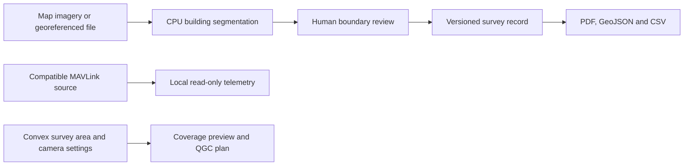

# GeoVision SIH presentation pack

This pack supports a demonstration of the supplied SIH26012 brief. It is not a
claim that all official problem-statement deliverables or field validation are
complete. Check the full official brief before submitting.

## Demonstrate what can be verified

Use the five-minute [walkthrough](SIH_DEMO.md). A repeatable
[offline rehearsal](REHEARSAL.md) exercises imports, actual model inference,
records, edits/history, exports and route planning with isolated sample data.
The [benchmark workspace](BENCHMARK_WORKFLOW.md) prepares independent labeling
and refuses to generate an accuracy score while its references/review are empty.

No flight or camera command is sent by this application. A preview route requires
configuration and pilot review in the ground-control workflow.

## Questions judges may ask

**Have you used a real drone?**

Not yet. The current demonstrations use map imagery and georeferenced files.
Packaging a map sample as GeoTIFF tests the import pipeline; it is not a drone
capture, stitching or orthorectification result. The local telemetry adapter
still needs a compatible aircraft/controller and field test.

**How accurate is the detection?**

Independent local accuracy is not yet measured. Proposal counts and model
confidence are different from precision and recall. The new benchmark freezes
the AOI, source, raw predictions, settings and model hash, then waits for
independent labels and a second reviewer before computing reference agreement
at IoU 0.50 and 0.75. Review declarations cannot prove independence by themselves.

**Did you train a new model?**

The supplied `best.pt` checkpoint is unchanged. Improvements to the workflow
preserve native image detail, handle overlapping windows, reconcile repeated
proposals and support corrections; they do not establish a new training result.

**Why did one demonstration show 76 buildings and another show 72?**

They used different scan extents. They are separate observations, not evidence
of an accuracy improvement. Compare models/settings only on the same frozen
reference area with the same boundary policy.

**Can a detected roof mark legal ownership?**

No. Building footprints and parcel references are distinct layers. Parcels can
be drawn or imported for review against authorized records. Entered owner claims
and a reviewed status do not establish ownership or government approval.

**What does the PDF prove?**

It records the saved geometry, calculated measurements, source and record
version. It is survey evidence, not a title deed. Temporary public-demo PDFs
omit permanent verification links. Local verification links share the associated
snapshot with anyone possessing that link.

**What works without internet?**

After dependencies/model installation, an existing georeferenced source can be
processed locally and saved records can be reviewed/exported. Map fetching and
the public tunnel need internet. Keep the permitted sample and local installation
ready before presenting; a cached background map is not guaranteed.

**Can it connect to any drone?**

The local adapter reads telemetry from compatible MAVLink sources over supported
UDP, TCP or serial links. Proprietary controllers may need their own supported
SDK or bridge. No camera capture, arming or flight execution is implemented.
Physical connections are disabled in public guest mode.

**Is the hosted app a permanent production service?**

The public project page and source are persistent entry points. The interactive
demo uses a temporary laptop tunnel with disposable visitor data and limits.
Production hosting, operations, team approval roles and hardware validation
remain separate deployment work.

## What to bring

- The editable deck and its speaker notes from the local `outputs/SIH` folder.
- A genuine sample survey PDF and GIS export, labeled as sample data.
- The sanitized offline rehearsal report and its timestamp/model hash.
- The private labeling kit, with its unfinished labels/review clearly identified.
- The local application and permitted imagery for internet failure.
- The backup video labeled as recorded still-frame evidence, not a live scan.

Keep raw source imagery, private databases, session data and backups outside the
public submission unless their disclosure and redistribution are authorized.
